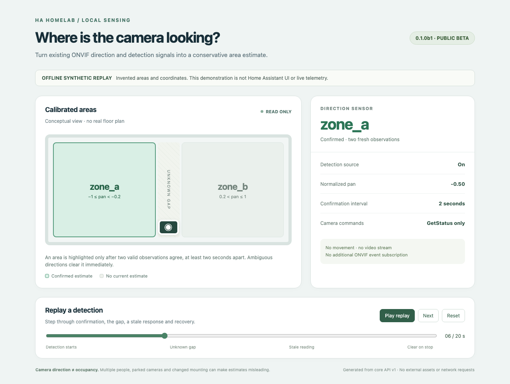

# ONVIF Room Direction

An event-gated Home Assistant sensor that estimates which calibrated area an ONVIF camera points toward. It reuses the existing ONVIF integration's authenticated client and reads PTZ status while a selected detection sensor is on.

**Public beta · 0.1.0 · Home Assistant 2026.10.0 API baseline**

This is a camera-direction estimate. It does not identify people or establish occupancy. It never sends camera movement commands, opens a video stream, creates another ONVIF event subscription, or stores camera credentials. Multiple cameras are supported through separate config entries.



The screenshot is a browser capture of the included [offline synthetic replay](docs/demo.html), not the Home Assistant interface and not a real home. Open the HTML locally to step through confirmation, an unknown gap, and a stale response.

## Install the beta

1. Configure and verify your camera in Home Assistant's built-in **ONVIF** integration. The camera must expose PTZ `GetStatus`, normalized pan, and a fresh timezone-aware `UtcTime`. No specific camera models are certified in this beta.
2. Download `onvif_room_direction.zip` and `SHA256SUMS` from [Releases](https://github.com/ha-homelab/ha-onvif-room-direction/releases). Verify the checksum, create `config/custom_components/onvif_room_direction/`, and unzip the archive **into that directory**. `manifest.json` must sit directly inside it.
3. Restart Home Assistant. Go to **Settings → Devices & services → Add integration → ONVIF Room Direction**.
4. Choose the existing ONVIF camera, one or more binary detection sensors, a display name, and calibrated sectors. The displayed example values are synthetic: replace them before using the estimate.
5. Open the new integration's options to adjust sectors, sources, enablement, confirmation, polling, freshness and retry timing.

For HACS, add this repository as a custom **Integration** repository and enable prerelease versions. This project is not claiming inclusion in HACS's default catalog. The release archive is designed for HACS extraction into the integration directory.

When upgrading, back up the integration folder and keep the previous release ZIP. Replace the files, restart, and verify one controlled detection. To roll back this beta, restore the previous integration folder and restart. Removing this helper leaves the built-in ONVIF integration intact.

## Configuration

All sample IDs and coordinates are invented. Each sector has an area label and normalized bounds:

```json
[
  {"area": "zone_a", "min": -1, "max": -0.2},
  {"area": "zone_b", "min": 0.2, "max": 1}
]
```

Labels use letters, digits and underscores, beginning with a letter; matching is case-sensitive. They are sensor values, not automatic Home Assistant area assignments. Ranges must not overlap. Inner endpoints are unknown; the normalized outer limits -1 and +1 are included. Gaps deliberately remain unknown. A label can appear in multiple disjoint sectors.

Defaults, in seconds: poll 2, confirmation 2, failed-read retry 10, request timeout 4, maximum camera position age 15, permitted future clock skew 5. Confirmation needs two valid observations separated by at least the configured interval. An observation timeout or invalid/stale response clears the estimate and requires confirmation again. A freshness timer clears a result even while a later read is still pending.

Detection means **any** configured source is currently `on`, excluding restored states. With no active source the state is `unknown`, reason `idle`, and no polling occurs. Unknown/unavailable detection sources do not count as active. Turning the helper off in options gives `unknown`, reason `disabled`.

See [calibration](docs/calibration.md), [use cases](docs/use-cases.md), [troubleshooting and compatibility](docs/troubleshooting.md), and the [versioned extension API](docs/api.md).

## Development

The pure core and reader need Python 3.11+. Full integration checks need Python 3.14.2+ for the pinned Home Assistant release:

```sh
python3 -m venv .venv
.venv/bin/python -m pip install -e '.[test,ha-test]'
PYTHON=.venv/bin/python ./scripts/check.sh
```

The check runs lint, formatting, synthetic tests and deterministic ZIP packaging. It never contacts a camera or a Home Assistant server. To test just the portable API, install `.[test]` and run `python3 -m pytest tests/test_core.py tests/test_adapter.py`.

See [CONTRIBUTING](CONTRIBUTING.md) for screenshots and release validation, [SECURITY](SECURITY.md) for safe reports, and [CHANGELOG](CHANGELOG.md) for changes. MIT licensed.
